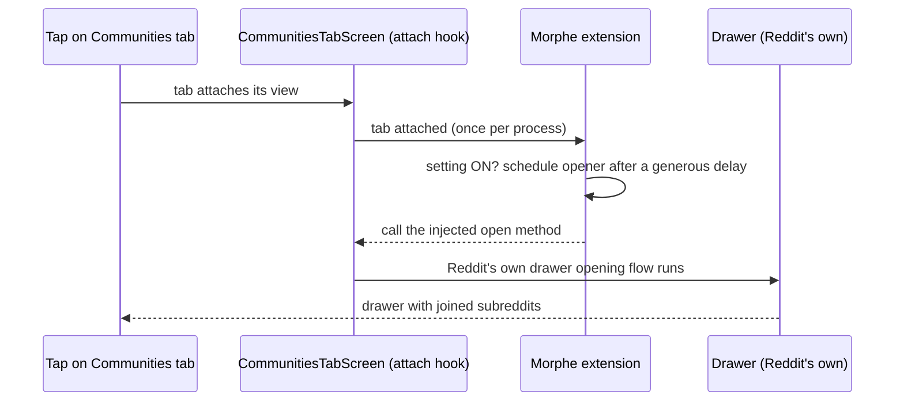

# S1 - The drawer opens on command

## In one sentence

After tapping the Communities tab, the app opens its own subreddit drawer from the patched
route - proving the risky half of the design (`pjb.a()` through an injected method) before
anything else is built.

## How it works

## What changes

- **The switch** - a new Morphe setting, *Navigation bar → Hide Home feed* (default off),
  with its English label; translated strings untouched.
- **The route** - the screen is taught one new method (morphe-opened) that reads the same
  lazy provider the tab's menu button uses, and calls Reddit's own drawer-opening flow, so
  Reddit's own checks and analytics stay in the path.
- **The trigger** - when the tab attaches, the extension schedules that method call once
  per process, after a deliberately over-generous delay (see choices).
- **Nothing else changes yet** - Home still appears and still opens; version rows,
  fingerprints for the start tab, and the tab hiding all come in S2. This step only
  proves the drawer can be opened on command.

## Choices you might want different

- **Generous fixed delay (~2 s)** instead of the final tuned value - during S1 the drawer
  opens right after a manual tap, so timing barely matters; the probe value is kept until
  S2's cold-start run tunes it. (Ponytail, by design.)
- **First taps are manual** - the S1 device run needs "tap Communities" once; the check
  automates the tap via adb, so the only human involvement left is the fresh app's first
  sign-in and turning the toggle on, since the patched install starts logged out.
