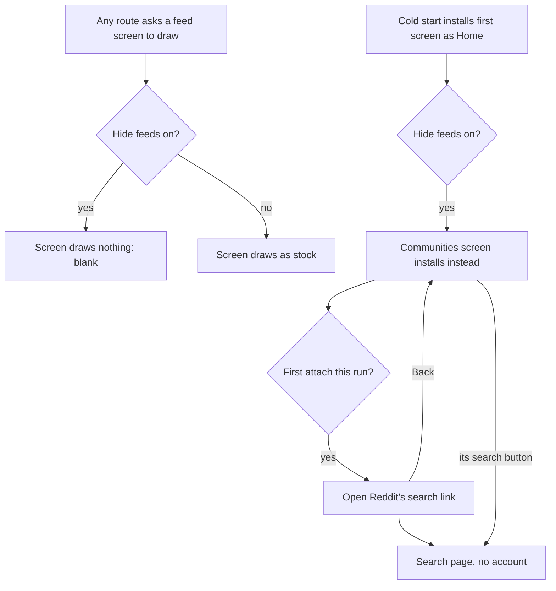

# S1 - No feed renders, and cold start lands on search

## In one sentence

With *Hide feeds* on, Reddit's five feed screens cannot draw at all, the old drawer route is
gone, and a cold start - with no Communities tab in the bar - opens on Reddit's own search
page, still as a guest with no login.

## How it works

## What changes

- **Five feed screens** - Discover, Home, Popular, Latest and News now ask the switch before
  drawing. When it is on they draw nothing, whatever route reached them.
- **The landing** - the patch replaces the cold start's first-screen request of Home with
  Communities (hook 1, the decision's Option A). The Home button itself never leaves the bar:
  hiding it would leave no way back on a phone whose bar has no Communities slot. On the
  Communities screen's first attach, the app opens Reddit's own search link once per run; the
  once-only flag stops the link re-triggering itself.
- **The start tab is protected** - even with "Hide Discover or Communities button" on, the
  landing surface cannot be removed from the bar. Whether it is labelled Communities stays
  server-controlled.
- **The switch** - the saved key is unchanged; its label becomes *Hide feeds*, because it
  now covers all five feed screens.
- **Failure is loud** - if any of the five screens cannot be found while patching, the patch
  fails; each hook call is also re-checked at instruction index 0 after injection, and a
  miss fails the patch too.
- **Back from search** - Reddit's own back stack returns to the Communities tab, whose body
  is now blank, so the Discover feed no longer appears there; its top bar's search button
  returns to search.
- **Reddit in front first** - the device check only reads results from dumps where Reddit is
  the focused app; anything else is a harness error, never a result.

## Choices you might want different

- **Reddit's own search link** instead of a custom search screen - it keeps Reddit's routing
  and behavior, but it depends on the query-less link landing on the search page.
- **A blank feed page** instead of a spinner or message - a blank page is always acceptable
  per the requirement; anything friendlier would need a new screen.
- **No keyboard guarantee** - whether the search keyboard opens by itself is cosmetic and
  left to Reddit.

## Not in this step

- Tapping Home in the bar is not tested yet: Reddit still selects Home until hooks 2-3 land
  in S2, so a tap now would not prove anything about the start screen.
