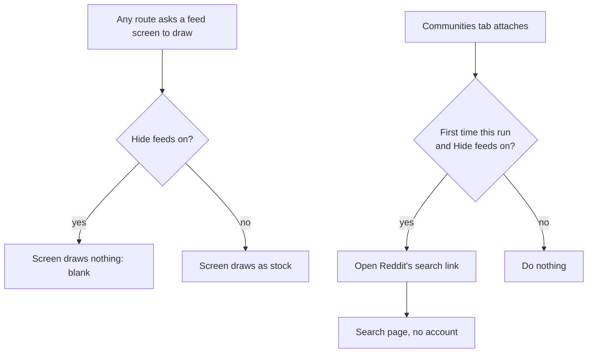

# S1 - No feed renders, and Communities opens search

## In one sentence

With *Hide feeds* on, Reddit's five feed screens cannot draw at all, the old drawer route is
gone, and tapping Communities opens Reddit's own search page - still as a guest, with no
login.

## How it works

## What changes

- **Five feed screens** - Discover, Home, Popular, Latest and News now ask the switch before
  drawing. When it is on they draw nothing, whatever route reached them.
- **The drawer route** - the previous attempt to auto-open the subreddit drawer is removed;
  it needed an account the owner will not use.
- **The landing** - when the Communities tab attaches, the app opens Reddit's own search link
  once per run. The once-only flag stops the link from re-triggering itself.
- **The switch** - the saved key is unchanged; its label becomes *Hide feeds*, because it
  now covers all five feed screens.
- **Failure is loud** - if any of the five screens cannot be found while patching, the patch
  fails instead of shipping with an unguarded feed.
- **Back from search** - Reddit's own back stack returns to the Communities tab, whose body
  is now blank, so the Discover feed no longer appears there.

## Choices you might want different

- **Reddit's own search link** instead of a custom search screen - it keeps Reddit's routing
  and behavior, but it depends on the query-less link landing on the search page.
- **A blank feed page** instead of a spinner or message - a blank page is always acceptable
  per the requirement; anything friendlier would need a new screen.
- **No keyboard guarantee** - whether the search keyboard opens by itself is cosmetic and
  left to Reddit.
